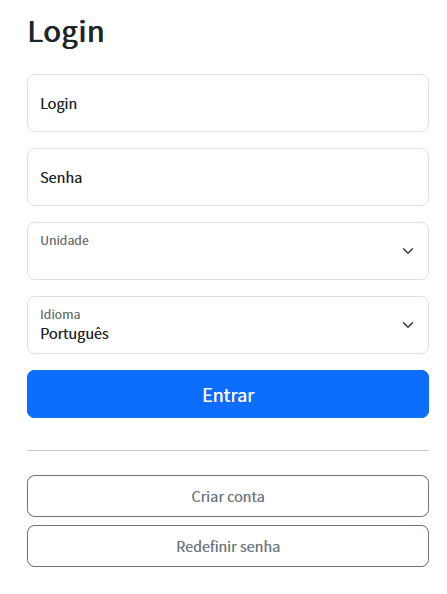
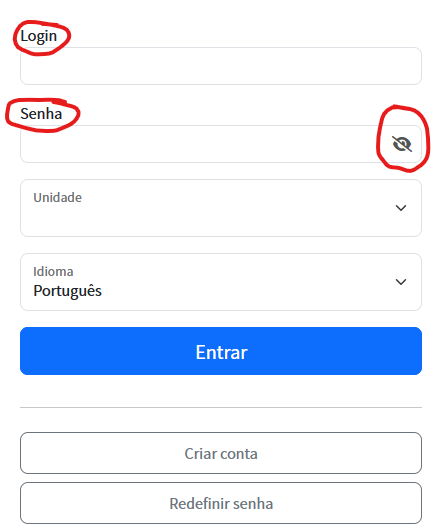
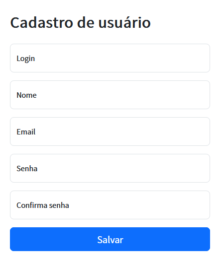
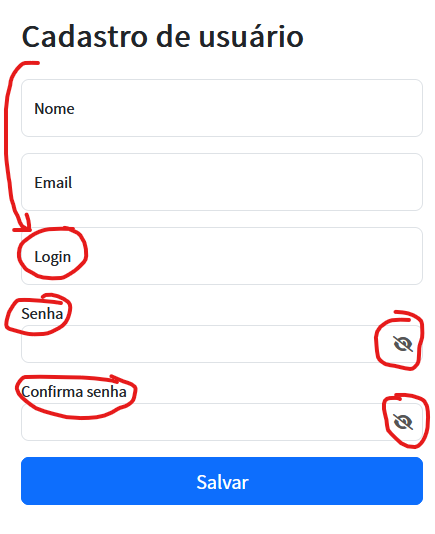

# Sobre Adianti
Informações sobre o Adianti e seu criador veja  [pagina principal](../README.md)

# Changelog do Adianti Fork Template v8.7.0.1

## Principais alterações

### 1 - Tema melhorado
Instlado tema adminbs5_v8, que é uma versão melhorada do tema adminbs5. Abaixo um resumo das melhorias para mais detalhes [Veja as mudanças no projeto adianti-theme > Temas para o Template > adminbs5_v8.md](https://github.com/bjverde/adianti-theme/blob/master/documents/template/adminbs5_v8.md)
1. Zoom no celular, com movimento de pinça
1. Houver no grid com amarelo
1. Possibilitar selecionar label do campo
1. Incluir barra sobre titulo
1. Incluir versão do sistema
1. Correção do Bug manifest version no login

### 2 Configurações do application
1. Imagem de funto tela login
1. Logo na tela de login
1. has_master_menu = 0 -> menu normal e não menu de icones
1. Atualizando Hash dos arquivos

### 3 - Habilitando Toggle Visibility do campo senha
Tela normal de login

Tela fork de login
* label sobre o campo
* desativando placeholder
* habilitanto Toggle Visibility

Tela cria conta normal

Tela fork cria conta normal
* campo login posição alterada
* campo senha e confirmação - desativando placeholder
* campo senha e confirmação - habilitanto Toggle Visibility

## ChangeLog por issue
1. :hammer: [#108 - Configurações gerais](https://github.com/bjverde/adianti-fork-template/issues/108)
    * remover tema adminbs5
    * instalar novo template adminbs5_v8 sobre o template
    * alterar o AdiantiMenuBuilder
    * alterar o application
    * alterar index.php váriaveis do tema
    * configurar img de fundo
    * configurar logo
    * Alterar nome titulo
    * desativando has_master_menu
2. :hammer: [#103  - Instalar o FormDin v5.15.1](https://github.com/bjverde/adianti-fork-template/issues/103)
3. :hammer: [#106 - Habilitar olho na senha](https://github.com/bjverde/adianti-fork-template/issues/106)
4. :hammer: [#107- Alterar caminho hash para o tema](https://github.com/bjverde/adianti-fork-template/issues/107)

# ChangeLog versões antigas
* [Changelog do Fork do Template do Adianti v8.7.0](changelog_fork_v8.7.0.md)
* [Changelog do Fork do Template do Adianti v8.6.0](changelog_fork_v8.6.0.md)
* [Changelog do Fork do Template do Adianti v8.4.0](changelog_fork_v8.4.0.md)
* [Changelog do Fork do Template do Adianti v8.3.0](changelog_fork_v8.3.0.md)
* [Changelog do Fork do Template do Adianti v8.2.0](changelog_fork_v8.2.0.md)
* [Changelog do Fork do Template do Adianti v8.1.0](changelog_fork_v8.1.0.md)
* [Changelog do Fork do Template do Adianti v8.0.0](changelog_fork_v8.0.0.md)
* [Changelog do Fork do Template do Adianti v7.6.0](changelog_fork_v7.6.0.md)
* [Changelog do Fork do Template do Adianti v7.5.1](changelog_fork_v7.5.1.md)
* [Changelog do Fork do Template do Adianti v7.3.0](changelog_fork_v7.3.0.md)